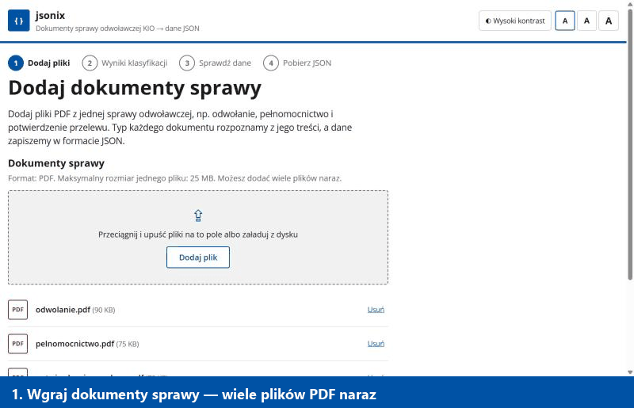

# jsonix

jsonix czyta dokumenty PDF ze sprawy odwoławczej KIO i zamienia je na dane JSON w formacie UZP. Sam rozpoznaje, czy dokument to odwołanie, pełnomocnictwo czy potwierdzenie przelewu, i wyciąga z niego pola. Przy każdej wartości zapisuje, z której strony i z którego fragmentu ją wziął. Dokument innego rodzaju dostaje plik z `{}`. Skany bez tekstu czyta lokalny OCR, bez GPU i bez wysyłania danych na zewnątrz. Nie używamy LLM.



Wersja **v1.0.1** · F1 wg reguł UZP: **0,998** (dev) / **0,994** (holdout) · [raport jakości](docs/raport-jakosci.md) · projekt HackNation 2026 (zadanie UZP)

## Instrukcja uruchomienia na VM

1. Wgraj dokumenty do `/opt/solution/input` — jeden podfolder na sprawę: `/opt/solution/input/<sprawa>/<plik>.pdf` (PDF-y luzem w `input/` też zadziałają).
2. Uruchom:

```bash
cd /opt/solution
sudo docker run --rm -e JSONIX_APP_CONFIG=config/app.jury.yaml -v /opt/solution/input:/app/input -v /opt/solution/output:/app/output jsonix:latest python -m odw2json run input output
```

3. Wyniki są w `/opt/solution/output/<sprawa>/<nazwa_pdf>.json` — jeden plik JSON na każdy PDF; dokument spoza trzech typów ma `{}`.

Ta sama komenda jest w [RUN.md](RUN.md). Kończy się sama, bez pytań i bez dostępu do sieci. Czas na VM (2 vCPU): dokument z tekstem ułamek sekundy, skan średnio ok. 12 s; 226 PDF-ów (w tym 30 skanów) — 6 minut.

## Uruchomienie u siebie

**Windows** (Python 3.13 lub 3.14 z [python.org](https://www.python.org/downloads/), z zaznaczonym „Add python.exe to PATH”):

```powershell
.\start-gui.bat     # aplikacja w przeglądarce: http://127.0.0.1:8000
.\start.bat         # wsad: PDF-y z input\<sprawa>\ → wyniki w output\<sprawa>\
```

Za pierwszym razem skrypt sam tworzy środowisko i instaluje zależności. Trwa to kilka minut i wymaga internetu. Potem aplikacja działa offline.

**Docker** (dowolny system):

```bash
docker compose up --build                            # aplikacja: http://127.0.0.1:8000
docker compose run --rm app python -m odw2json run   # wsad: input/ → output/
```

**Linux/macOS:** `pip install -r requirements.txt`, potem `sh start.sh` (wsad) albo `python -m odw2json serve` (aplikacja).

W aplikacji wgrywasz PDF-y sprawy i klikasz „Analizuj”. Potem sprawdzasz rozpoznany typ (wraz z uzasadnieniem „Dlaczego ten typ?”) i przeglądasz dane obok podglądu dokumentu. Ikonka „i” przy wartości pokazuje stronę i fragment źródła, a najechanie na pole podświetla je w PDF. Wartości można poprawić i pobrać jako JSON albo ZIP. Więcej: [docs/gui.md](docs/gui.md).

## Wyniki

F1 liczone wg reguł UZP na danych treningowych (podział dev/holdout):

| Zbiór | Razem | Dokumenty z tekstem | Skany (OCR) |
|---|---|---|---|
| dev | 0,998 | 0,999 | 0,992 |
| holdout | 0,994 | 0,997 | 0,967 |

Klasyfikacja nie popełnia błędów, a wszystkie dokumenty spoza typów dostają `{}` (15/15 i 13/13). Wyniki per typ i pole oraz czasy są w [raporcie jakości](docs/raport-jakosci.md). Skrypt `python scripts/quality_report.py` generuje go od nowa.

## Jak to działa

```
PDF → tekst z PDF albo OCR → rozpoznanie typu → wyodrębnienie pól → JSON wg schematu UZP (+ źródło każdej wartości)
```

- **Konfiguracja zamiast kodu.** Każdy typ dokumentu to plik `config/doctypes/<typ>.yaml`: jak go rozpoznać i skąd brać pola. Nowy typ dodaje się samą konfiguracją ([instrukcja](docs/nowy-typ-dokumentu.md), [przykład: orzeczenie KIO](examples/nowy-typ/orzeczenie_kio/README.md)).
- **Przejrzystość.** Każda wartość ma zapisaną stronę i fragment tekstu, z którego pochodzi. GUI pokazuje je w dokumencie.
- **Bez LLM.** Reguły dają F1 0,999 na dokumentach z tekstem, nic nie kosztują, działają lokalnie i dają powtarzalny wynik, a za moc modelu jest wtedy maksimum punktów. Uzasadnienie: [decyzja E6](docs/decyzje/E6-bez-llm.md). Opcjonalną warstwę LLM można włączyć w `config/app.yaml`, wyłącznie z modelem do 8B od dostawcy z UE.

Pełny opis: [docs/architektura.md](docs/architektura.md).

## Dokumentacja

| Dokument | Co zawiera |
|---|---|
| [RUN.md](RUN.md) | komenda dla jury na VM |
| [docs/vm-jury.md](docs/vm-jury.md) | wdrożenie i test na VM krok po kroku |
| [docs/architektura.md](docs/architektura.md) | architektura: etapy, kontrakty danych, konfiguracja, API i GUI |
| [docs/nowy-typ-dokumentu.md](docs/nowy-typ-dokumentu.md) | konfiguracja ekstrakcji i dodawanie nowej klasy dokumentów |
| [docs/gui.md](docs/gui.md) | aplikacja w przeglądarce |
| [docs/raport-jakosci.md](docs/raport-jakosci.md) | wyniki testów jakości |
| [docs/test-jury.md](docs/test-jury.md) | test instalacji ze świeżego klonu (Windows, Docker) |
| [docs/decyzje/E6-bez-llm.md](docs/decyzje/E6-bez-llm.md) | dlaczego bez LLM |
| [docs/zgloszenie.md](docs/zgloszenie.md) | zgodność z regulaminem, użyte komponenty open source i licencje |
| [docs/kryteria-uzp.md](docs/kryteria-uzp.md) | kryteria oceny i ustalenia organizatora |
| [CHANGELOG.md](CHANGELOG.md) | historia wersji |

## Dla programistów

```bash
pip install -r requirements-dev.txt
python -m pytest -q -m "not slow"                  # szybkie testy
python -m eval.gate --split dev --source tekst     # bramka jakości F1 (jak w CI)
```

CI na GitHub Actions uruchamia lint, testy, bramkę F1, testy dymne na Windows i Ubuntu oraz `docker build`. Jak liczymy F1: [eval/README.md](eval/README.md). Zasady pracy w repo: [AGENTS.md](AGENTS.md).

Dane treningowe pochodzą z [repozytorium UZP](https://github.com/Urzad-Zamowien-Publicznych/hacknation-2026).
