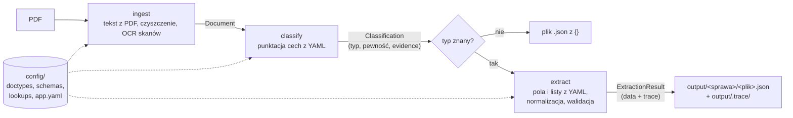

# Architektura jsonix

jsonix zamienia dokumenty PDF sprawy odwoławczej KIO na JSON zgodny ze schematami UZP. Rozpoznaje typ dokumentu **z treści** (odwołanie, pełnomocnictwo, potwierdzenie przelewu albo dokument nieznany), wyodrębnia pola i dla każdej wartości zapisuje, skąd pochodzi (strona i fragment tekstu). Całe zachowanie zależne od typu dokumentu jest w konfiguracji YAML, a nie w kodzie.

Pakiet Pythona nazywa się `odw2json` (komenda `python -m odw2json`). „jsonix” to nazwa wyświetlana.

## Przepływ danych

Ten sam potok obsługuje wszystkie wejścia: CLI (`python -m odw2json run`, `start.bat`), API i GUI (`odw2json.api` woła `pipeline.process_file_ex`) oraz kontener Docker. Dzięki temu GUI i CLI dają identyczne dane (sprawdza to `scripts/smoke_docker.py`).

## Etapy potoku

| Etap | Moduł | Wejście → wyjście | Konfiguracja |
|---|---|---|---|
| Wczytanie | `odw2json/ingest/` | PDF → `Document` (tekst stron, offsety, `ocr_used`, ostrzeżenia) | `config/app.yaml: ingest` |
| Klasyfikacja | `odw2json/classify/` | `Document` → `Classification` (`doc_type` albo `None`, `confidence`, `evidence`) | `config/doctypes/*.yaml: classify`, `config/classify.yaml` |
| Ekstrakcja | `odw2json/extract/` | `Document` + typ → `ExtractionResult` (`data` wg szablonu, `trace`) | `config/doctypes/*.yaml: fields, lists`, `config/lookups/` |
| Zapis | `odw2json/pipeline.py` | wynik → `output/<sprawa>/<plik>.json` i `output/.trace/…/<plik>.trace.json` | `config/app.yaml: unknown_output, write_trace` |

### Wczytanie (ingest)
- **Tekst z PDF:** backend wybierany w `config/app.yaml` (domyślnie `pypdfium2`, z kolejnymi `pypdf` i `pdfplumber`, gdy backend zawiedzie albo zwróci pusty tekst). Uzasadnienie: [decyzje/E2-backend-pdf.md](decyzje/E2-backend-pdf.md).
- **Czyszczenie:** lista czystych funkcji `str → str` uruchamianych w kolejności z konfiguracji: NFC, ligatury, cudzysłowy, artefakty stron, dzielenie wyrazów, łączenie wierszy, spacje (`ingest/clean.py`).
- **OCR:** strony z mniej niż `min_chars_per_page` znakami idą do RapidOCR (onnxruntime, CPU, modele w paczce, bez sieci). Wyniki są cache'owane po hashu pliku w `output/.cache/ocr`. Uzasadnienie i pomiary: [decyzje/E2-ocr.md](decyzje/E2-ocr.md), [decyzje/E2b-ocr-wydajnosc.md](decyzje/E2b-ocr-wydajnosc.md).

### Klasyfikacja (classify)
Każdy typ dokumentu ma w swoim YAML sekcję `classify:`: tytuł w nagłówku, frazy `strong`/`weak`/`negative`, wzorce z wagą, warunki konieczne `required_any` oraz progi `min_score` i `min_margin`. Wspólna kara `foreign_titles` z `config/classify.yaml` obniża wynik dokumentom, które zaczynają się nagłówkiem obcego pisma (np. wyrok, faktura).

Wygrywa typ z najwyższym wynikiem, jeśli przekracza próg i ma wystarczającą przewagę nad drugim. W przeciwnym razie dokument jest **nieznany**, a wynik to plik `.json` z `{}`. Lista trafionych cech trafia do `evidence`; GUI pokazuje ją jako „Dlaczego ten typ?”. Nazwa pliku nie jest używana. Szczegóły: [decyzje/E3-klasyfikacja.md](decyzje/E3-klasyfikacja.md).

### Ekstrakcja (extract)
Sekcje `fields` i `lists` typu dokumentu opisują każde pole wyniku:
- **gdzie szukać:** zakres i okna `within`;
- **czym szukać:** rejestr ekstraktorów, np. regex po etykiecie, flaga, klasyfikacja frazami ze słownika;
- **jak znormalizować wartość:** daty ISO, kwoty, numery BZP i TED, poprawki OCR, imiona i nazwiska w mianowniku;
- **jak ją sprawdzić:** walidatory.

Pola wyliczane (np. `czynnosc_opis` ze słownika według `czynnosc_powod_id`) mają metodę `derived`. Nowy ekstraktor, normalizator lub walidator rejestruje się w kodzie raz i od tej pory jest dostępny dla każdego typu z YAML. Opis składni i decyzje dla trzech typów: [nowy-typ-dokumentu.md](nowy-typ-dokumentu.md) oraz `docs/decyzje/E4-ekstrakcja.md` (etap E4).

Gdy ekstrakcja nie znajdzie wartości, zwraca `null`. Wartości nie są zmyślane.

## Kontrakty (`odw2json/contracts.py`)
Etapy łączą wspólne struktury danych, które zmieniają się tylko za zgodą właściciela projektu:
- `Document`: ścieżka, pełny tekst, tekst stron, offsety początków stron, `ocr_used`, backend, ostrzeżenia.
- `Classification`: `doc_type` (`None` dla dokumentu nieznanego), `confidence` w [0, 1], `method`, `scores`, `evidence`.
- `FieldResult`: jeden wpis **trace** z polami `path` (np. `Odwolujacy[0].nip`), `value`, `method` (np. `regex`, `label`, `derived`), `source_snippet` (fragment tekstu po czyszczeniu) i `page` (numer strony liczony od 0).
- `ExtractionResult`: `doc_type`, `data` (JSON dokładnie wg `config/schemas/<typ>.json`) i `trace`.

Trace jest podstawą transparentności. CLI zapisuje go obok wyniku (`output/.trace/`), a GUI używa `page` i `source_snippet`, żeby podświetlić źródło wartości w podglądzie PDF.

## Konfiguracja (`config/`)

| Plik | Co ustawia |
|---|---|
| `doctypes/<typ>.yaml` | identyfikator, nazwa, szablon wyniku, reguły klasyfikacji (`classify`), reguły pól (`fields`, `lists`) |
| `schemas/<typ>.json` | szablon wyniku UZP: kolejność kluczy i `null` jako wartość domyślna |
| `lookups/*.yaml` | słowniki, np. powód odwołania → opis czynności, frazy czynności, końcówki imion |
| `classify.yaml` | ustawienia wspólne dla klasyfikacji (nagłówki dokumentów obcych) |
| `app.yaml` | zachowanie aplikacji: plik dla nieznanego dokumentu, trace, backend PDF, czyszczenie, OCR, przełącznik LLM |
| `llm.yaml`, `prompts/` | opcjonalna warstwa LLM (domyślnie wyłączona) |

**Nowy typ dokumentu** to nowy plik `doctypes/<typ>.yaml` i szablon `schemas/<typ>.json`, bez zmian w kodzie. Instrukcja krok po kroku: [nowy-typ-dokumentu.md](nowy-typ-dokumentu.md). W Dockerze katalog `config/` jest montowany z repo, więc zmiana konfiguracji nie wymaga przebudowy obrazu.

## LLM (opcjonalny, domyślnie wyłączony)
Domyślnie jsonix działa **bez LLM** (`app.yaml: llm_enabled: false`): klasyfikacja i ekstrakcja opierają się na regułach z konfiguracji. Klient LLM (`odw2json/llm.py`) obsługuje dowolne API zgodne z OpenAI, z kluczem w `.env`, temperaturą 0 i kasetami odpowiedzi do testów bez sieci.

Zgodnie z ustaleniami UZP dopuszczamy wyłącznie model open source od firmy z serwerami w UE/EOG i polityką prywatności, która określa zakres i miejsce przetwarzania danych. Bierzemy pod uwagę tylko modele do 8B parametrów, bo tyle nie obniża punktacji za rozmiar modelu. Kryteria: [kryteria-uzp.md](kryteria-uzp.md).

## Aplikacja: API i GUI
- **API** (FastAPI, `python -m odw2json serve`, opis OpenAPI pod `/docs`):
  - `POST /api/jobs`: wiele PDF; przetwarzanie w tle, najwyżej 2 joby naraz, pozostałe czekają w kolejce;
  - `GET /api/jobs/{id}`: stan i postęp;
  - pobieranie wyników: `GET /api/jobs/{id}/files/{name}/pdf`, `/json` oraz `GET /api/jobs/{id}/zip`;
  - pozostałe: `GET /api/doctypes`, `GET /api/health` oraz synchroniczne `POST /api/process` (zgodność wsteczna).
  - **Limity:** 50 plików i 200 MB na żądanie, 25 MB na plik; konfiguracja przez zmienne środowiskowe.
  - **Bezpieczeństwo nazw:** nazwy plików są sanityzowane (ochrona przed path traversal i nazwami zarezerwowanymi Windows).
- **GUI** (`web/static/`): statyczny HTML, CSS i JS bez kroku budowania, serwowany przez FastAPI. PDF.js i fonty są dołączone lokalnie, więc GUI działa offline. Styl wg Design System Gov.pl, pełna obsługa klawiaturą, projekt zgodny z WCAG 2.1 AA (deklaracja dostępności w GUI). Pola wyniku są widoczne obok podglądu PDF z podświetleniem źródła (kliknięcie albo najechanie, w obie strony) i z ręczną edycją wartości. Szczegóły: [gui.md](gui.md).

## Jakość
- **F1 wg reguł UZP:** `eval/score.py`. Długie teksty porównujemy z progiem podobieństwa 80%, pozostałe pola dokładnie, listy po treści.
- **Bramka regresji:** `python -m eval.gate --split dev|holdout [--source tekst|skan]`. Porównuje wynik z `eval/baseline.json` i kończy się kodem 1 przy spadku F1. Podział spraw na dev i holdout jest deterministyczny (`data/splits.yaml`); holdout sprawdzamy rzadko, żeby nie dopasować reguł do zbioru testowego.
- **CI (GitHub Actions, Ubuntu i Windows, Python 3.13):** ruff, pytest, bramka F1 na dev i holdout, smoke CLI, `docker build`. Lokalnie dochodzą `scripts/smoke_gui.py` (API i GUI) oraz `scripts/smoke_docker.py` (Compose, healthcheck, wsad w kontenerze porównany z CLI).

## Uruchomienie
- **CLI:** `pip install -r requirements.txt`, potem `start.bat` (Windows) albo `start.sh`, co odpowiada `python -m odw2json run input output`.
- **GUI:** `start-gui.bat` albo `python -m odw2json serve`, potem http://127.0.0.1:8000.
- **Docker:** `docker compose up --build`; plik `.env` jest opcjonalny.

## Mapa repozytorium

| Ścieżka | Zawartość |
|---|---|
| `odw2json/` | kod: `ingest/`, `classify/`, `extract/`, `pipeline.py`, `api/`, `cli.py`, `contracts.py`, `config_loader.py`, `llm.py` |
| `config/` | konfiguracja typów dokumentów i aplikacji (tabela wyżej) |
| `web/static/` | GUI (HTML/CSS/JS, `vendor/` z PDF.js i fontami oraz ich licencjami) |
| `eval/` | F1 wg UZP, bramka regresji, pokrycie tekstu |
| `data/train/` | dane treningowe UZP (`przyklad_*`, `negatywne/`, `skany/`) i podział `splits.yaml` |
| `tests/` | testy (pytest; logika JS przez Node, jeśli jest zainstalowany) |
| `scripts/` | smoke testy, benchmarki, narzędzia |
| `docs/` | kryteria UZP, ta architektura, GUI, nowy typ dokumentu, decyzje (`decyzje/`), plany etapów |
