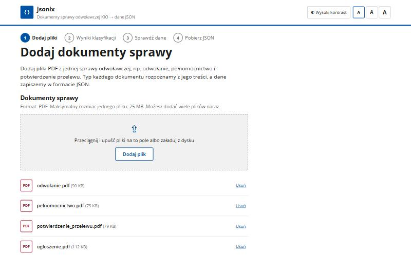
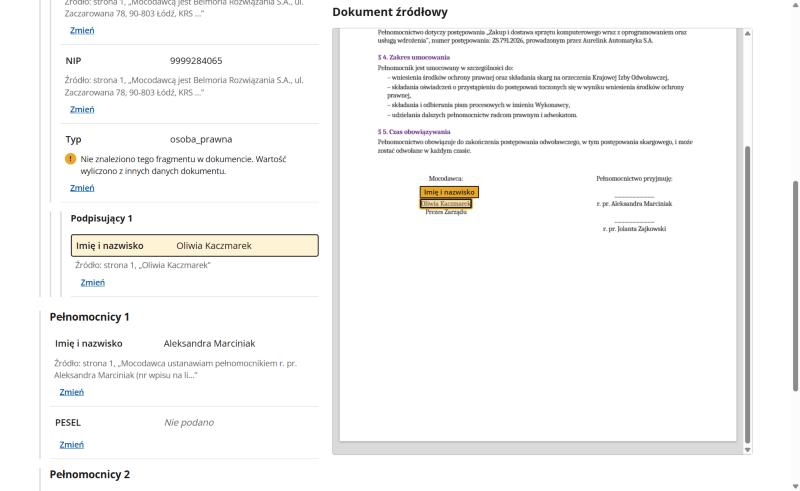

# Finał: scenariusz demo, plan slajdów, pytania jury

Materiał dla zespołu na prezentację finałową. Ocena w finale to 50% F1 i 50% elastyczność:
- moc modelu LLM: bez LLM albo średnio ≤ 8B daje maksymalne 20 pkt;
- łatwość dodawania typów i pól bez przebudowy: 20 pkt;
- inne funkcje, np. GUI: 10 pkt.

Źródło kryteriów: [kryteria-uzp.md](kryteria-uzp.md). Liczby F1 pochodzą z pomiaru 21.11 na gałęzi E4 (Docker, OCR, `scripts/quality_report.py`); po scaleniu E4 potwierdź je tym samym skryptem. Do uzupełnienia zostaje skład zespołu (⟨…⟩).

## Przygotowanie (15 minut przed)

1. Świeży klon z `main` i jeden z dwóch sposobów uruchomienia:
   - `docker compose up --build`, potem `docker compose ps` musi pokazać `healthy`;
   - albo `start-gui.bat` (Python 3.13 i `pip install -r requirements.txt`).
2. Pliki do pokazu w jednym folderze na pulpicie:
   - `data/train/przyklad_01/odwolanie.pdf`, `pelnomocnictwo.pdf`, `potwierdzenie_przelewu.pdf`;
   - jeden skan, np. `data/train/skany/potwierdzenia/0007/0007.pdf` (OCR);
   - jeden dokument spoza typów, np. `data/train/negatywne/2025-OJS107-00364525-pl-ts-1.pdf` (ogłoszenie).
3. Przeglądarka w trybie pełnoekranowym, powiększenie 110–125%, wyłączony tryb wysokiego kontrastu.
4. Rozgrzej OCR: przetwórz skan raz przed pokazem (cache OCR w `output/.cache/ocr`), żeby na scenie nie czekać.
5. Drugie okno: terminal w katalogu repo oraz otwarty `config/doctypes/pelnomocnictwo.yaml`.

## Scenariusz pokazu (ok. 7 minut)

| # | Czas | Co robisz | Co mówisz (sedno) |
|---|---|---|---|
| 1 | 0:30 | Ekran „Dodaj pliki”, przeciągasz 5 plików | „Sekretariat KIO dostaje komplet dokumentów sprawy. Wrzucamy je naraz, bez nazywania i sortowania.” |
| 2 | 0:45 | „Analizuj”, pasek „Przeanalizowano N z 5” | „Każdy dokument przechodzi przez ten sam potok co wersja wsadowa: tekst z PDF albo OCR, klasyfikacja, ekstrakcja.” |
| 3 | 1:00 | Tabela wyników; rozwijasz „Dlaczego ten typ?” przy pełnomocnictwie i „Dlaczego nie rozpoznano?” przy ogłoszeniu | „Typ rozpoznajemy z treści, nie z nazwy pliku. System pokazuje, dlaczego tak zdecydował. Dokument spoza typów dostaje pusty JSON `{}`, tak jak wymaga UZP.” |
| 4 | 1:30 | „Sprawdź dane” przy odwołaniu; najeżdżasz kursorem na NIP, potem klikasz Tytuł | „Każda wartość ma źródło: strona i fragment. Najechanie podświetla je w dokumencie, kliknięcie przewija. Działa też odwrotnie: najedź na fragment w PDF.” |
| 5 | 0:45 | Pełnomocnictwo: klikasz imię i nazwisko podpisującego | „Imiona sprowadzamy do mianownika, jak wymaga UZP. Tu widać, z którego podpisu pochodzą.” |
| 6 | 0:30 | „Zmień” przy jednym polu, zapis, potem „Przywróć wartość z dokumentu” | „Urzędnik może poprawić wartość. Zmiana jest oznaczona, a oryginał da się przywrócić. Pobrany JSON zawiera poprawkę.” |
| 7 | 0:30 | „Pobierz wszystkie wyniki (ZIP)”, otwierasz jeden JSON | „Wynik ściśle wg schematu UZP: kolejność kluczy, `null` tam, gdzie dokument nie podaje wartości. Niczego nie zmyślamy.” |
| 8 | 1:00 | Terminal: `start.bat`, potem `output/` i `output/.trace/` | „To samo bez GUI, wsadowo, dla folderu `input/`. Trace zapisuje metodę i źródło każdej wartości: to transparentność ekstrakcji.” |
| 9 | 0:30 | Pokazujesz `config/doctypes/*.yaml` i [nowy-typ-dokumentu.md](nowy-typ-dokumentu.md) | „Nowy typ dokumentu to plik YAML i szablon JSON, bez zmian w kodzie. Na żywo: skopiuj 3 pliki z `examples/nowy-typ/orzeczenie_kio`, uruchom na postanowieniu KIO — wynik z 8 polami; potem usuń pliki.” |

Zrzuty ekranu do slajdów są w `docs/img/`: `gui-dodaj-pliki.jpg`, `gui-dlaczego-ten-typ.jpg`, `gui-hover-pole.jpg`, `gui-hover-dokument.jpg` i `gui-zaznaczenie-podpis.jpg`.

### Plan B
- **Docker nie startuje:** `start-gui.bat` (lokalny Python 3.13).
- **GUI nie działa:** sam CLI (`start.bat`) i pliki z `output/`, w tym `.trace/`.
- **Sieć niedostępna:** nic nie trzeba zmieniać. Aplikacja działa offline: PDF.js, fonty i modele OCR są lokalne, LLM domyślnie wyłączony.
- **OCR za wolny na sprzęcie prezentacyjnym:** skan przetworzony wcześniej czeka w cache (krok 4 przygotowania).

## Plan slajdów (10 slajdów)

Gotowa prezentacja według tego planu: [prezentacja.html](prezentacja.html) (otwórz w przeglądarce z repo; ← → slajdy, F pełny ekran, Ctrl+P zapis do PDF). Miejsca ⟨…⟩ są zaznaczone na czerwono.

1. **jsonix:** dokumenty sprawy KIO → dane JSON. Jedno zdanie o problemie i zrzut GUI.
2. **Problem:** ręczne przepisywanie danych z odwołań, pełnomocnictw i potwierdzeń przelewu; skany bez tekstu; różne układy dokumentów.
3. **Jak działa:** diagram potoku z [architektura.md](architektura.md) (PDF → ingest/OCR → klasyfikacja → ekstrakcja → JSON + trace).
4. **Jakość (F1 wg reguł UZP):**
   - dokumenty z tekstem: dev 99,9%, holdout 99,7%; skany: dev 97,5%, holdout 90,3%;
   - klasyfikacja: 0 błędów na dev i holdout, dokumenty spoza typów 12/12 i 10/10;
   - jak liczymy: `eval/score.py` wg reguł UZP, bramka regresji w CI.
5. **Transparentność:** podświetlenie źródła w PDF, trace z metodą i fragmentem, „Dlaczego ten typ?”.
6. **Bez LLM, z wyboru:**
   - reguły z konfiguracji dają F1 99,9% / 99,7% bez kosztów i bez wysyłania danych poza komputer;
   - 20/20 pkt za rozmiar modelu;
   - warstwa LLM jest gotowa jako opcja, tylko model ≤ 8B u dostawcy z UE.
7. **Nowy typ bez kodu:** fragment YAML i szablonu; demo 4. typu z `examples/nowy-typ/orzeczenie_kio` (E10); dodanie pola = wpis w YAML.
8. **GUI dla urzędnika:**
   - wiele plików naraz, PDF obok danych, edycja z przywracaniem, ZIP;
   - Gov.pl, klawiatura, wysoki kontrast, deklaracja dostępności.
9. **Gotowe do wdrożenia:**
   - Docker Compose z healthcheckiem, CLI `start.bat`;
   - testy i bramka F1 w CI, smoke testy;
   - działa offline na CPU (i7 / 16 GB, bez GPU).
10. **Zespół i rozwiązania zewnętrzne:** lista komponentów open source z licencjami (z [zgloszenie.md](zgloszenie.md)), zgodnie z §4 regulaminu.

## Pytania jury: przygotowane odpowiedzi

- **Dlaczego bez LLM?** Reguły z konfiguracji osiągają F1 99,9% (dev) i 99,7% (holdout) na dokumentach z tekstem. Decyzja: `docs/decyzje/E6-bez-llm.md`. LLM dodałby koszt, zależność od sieci i ryzyko zmyślania wartości, a punktów za rozmiar modelu nie zwiększy. Warstwa LLM jest gotowa jako opcja (`config/llm.yaml`, model ≤ 8B, dostawca z UE).
- **Co z dokumentem w innym układzie?** Klasyfikacja opiera się na wielu cechach naraz (tytuł, słowa kluczowe, wzorce, cechy wykluczające), a nie na pozycji tekstu. Ekstrakcja szuka po etykietach i w oknach tekstu. Brak wartości daje `null`, a nie zgadywanie. ⟨Wyniki testu odporności z review E4.⟩
- **Jak dodać nowe pole?** Wpis w `config/doctypes/<typ>.yaml` (ekstraktor, normalizator, walidator) i klucz w szablonie `config/schemas/<typ>.json`. Kod się nie zmienia.
- **Skany?** OCR RapidOCR na CPU, modele w paczce, bez sieci. Wynik OCR jest cache'owany po hashu pliku.
- **Bezpieczeństwo danych?** Wszystko działa lokalnie i offline. Serwer nasłuchuje na `127.0.0.1`. Pliki jobów są usuwane po 24 h. Nazwy plików są sanityzowane.
- **Skąd wiadomo, że wynik jest dobry?** Bramka F1 w CI blokuje regresję. Holdout sprawdzamy rzadko, żeby nie dopasować reguł do zbioru testowego. W GUI każdą wartość widać obok źródła.
